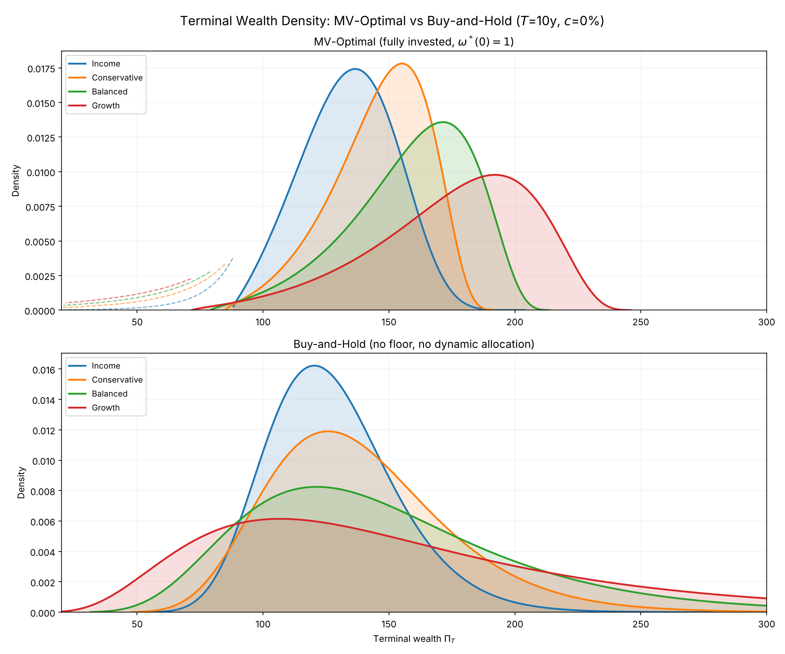
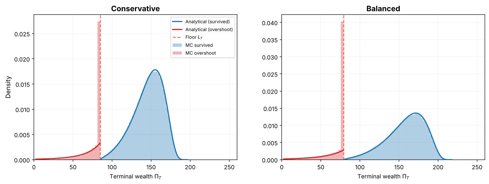
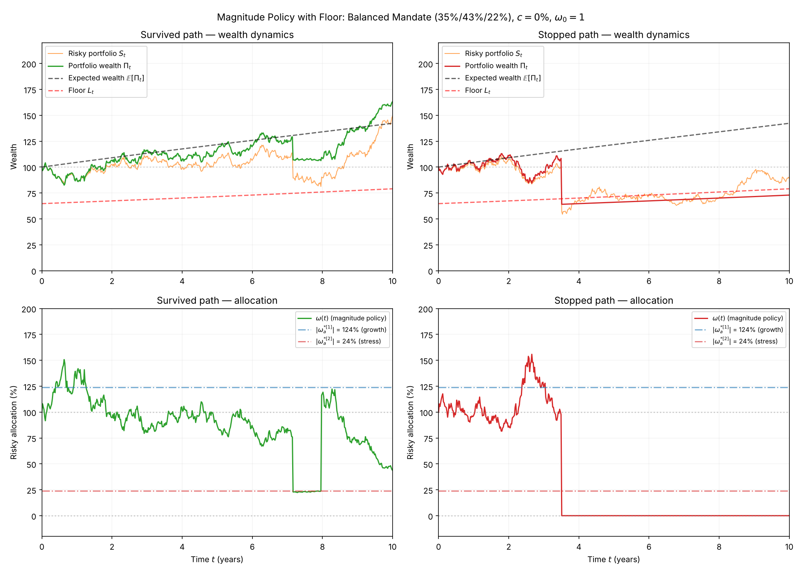
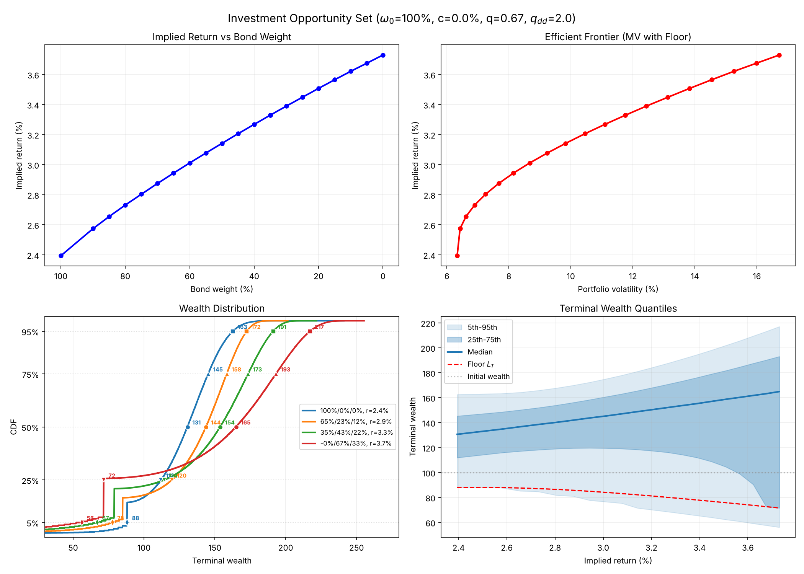

# goal-based-allocation

**Semi-analytical dynamic mean-variance allocation and terminal-wealth risk under regime-switching jump-diffusions**

The package models two regimes and an absorbing wealth floor; it is not a discrete constrained
multi-asset optimiser, trading engine, or production portfolio-management system.

**Install:** `pip install "goal-based-allocation==0.5.1"` · **Import:** `goal_based_allocation` · **Status:** Beta

[](https://pypi.org/project/goal-based-allocation/)
[](https://pypi.org/project/goal-based-allocation/)
[](https://github.com/ArturSepp/GoalBasedAllocation/actions/workflows/ci.yml)
[](https://goalbasedallocation.readthedocs.io/en/stable/)
[](LICENSE)
[](https://pepy.tech/project/goal-based-allocation)
[](https://pepy.tech/project/goal-based-allocation)

**Paper:** companion code to Sepp, A. (2026), *Dynamic Mean-Variance Portfolio Allocation under
Regime-Switching Jump-Diffusions with Absorbing Barriers and Distribution Matching* —
[SSRN 6534579](https://papers.ssrn.com/sol3/papers.cfm?abstract_id=6534579). See
[Statement of need](#statement-of-need) for what the package implements from it and
[Citation](#citation) for the BibTeX entries.

**Documentation:** [stable 0.5.1](https://goalbasedallocation.readthedocs.io/en/stable/) ·
[development (latest)](https://goalbasedallocation.readthedocs.io/en/latest/) ·
[getting started](docs/getting-started.md) · [paper index](papers/README.md)

---

## Why goal-based-allocation

This package provides a **semi-analytical Laplace-transform framework** for dynamic
mean-variance (MV) portfolio allocation under a two-state regime-switching model
with exponential jumps at regime transitions and an absorbing wealth floor. The transforms are
analytical; their inversion and the Riccati system are solved numerically. No Monte Carlo
simulation is needed for pricing; MC is used only for validation.

It models two regimes and multi-asset mandates aggregated to one effective risky
asset. It is not a discrete constrained multi-asset optimiser, trading engine, or
production portfolio-management system; use
[`optimalportfolios`](https://github.com/ArturSepp/OptimalPortfolios) for rolling
multi-asset construction, constraints, transaction costs, and backtesting.

### Key differentiators

- Analytical survival probability, conditional moments, and tilted survival via Laplace transforms
- Riccati ODE system for the MV-optimal policy with regime-dependent coefficients
- Full terminal wealth density decomposition (survived + floor atom + overshoot)
- Exact buy-and-hold moments under regime-switching via 2×2 matrix exponential
- Portfolio mandate construction with deterministic quadrature for jump aggregation
- Expected allocation glide paths with variance bands
- Investment opportunity set construction for client-facing portfolio advice
- Vanilla option pricing under the same regime-switching jump-diffusion via one Laplace inversion (calls/puts, both regimes, joint strikes)
- Monte Carlo simulator for independent validation of the semi-analytical results
- Integration tests and all paper figures reproducible from a single command

### When to use it — and when not

Use `goal-based-allocation` to design goal-based mandates under regime switching: survival and
shortfall probabilities against a wealth floor, MV-optimal allocation intensities and glide paths,
terminal wealth distributions, investment opportunity sets for client advice, and regime-switching
vanilla option pricing on the same Laplace engine. Analytical transforms and deterministic
numerical inversion produce the results; Monte Carlo is reserved for validation.

The model is deliberately parsimonious: two regimes, exponential jumps at transitions, and
multi-asset mandates reduced to a single effective asset via portfolio aggregation. For discrete
rolling multi-asset optimisation with weight constraints, transaction costs and backtesting, use
`optimalportfolios`.

## Installation

```bash
pip install "goal-based-allocation==0.5.1"
```

Or clone and install in development mode:

```bash
git clone https://github.com/ArturSepp/GoalBasedAllocation.git
cd GoalBasedAllocation
pip install -e .
```

Requires Python >= 3.11 with NumPy >= 2.0, SciPy >= 1.10, and Matplotlib >= 3.8.4. The package
is standalone within the stack: these are its only runtime dependencies.

## Table of contents

1. [Why goal-based-allocation](#why-goal-based-allocation)
2. [Installation](#installation)
3. [Statement of need](#statement-of-need)
4. [Overview](#overview)
5. [Five-minute quickstart](#five-minute-quickstart)
6. [Examples](#examples)
7. [Testing](#testing)
8. [Changelog](#changelog)
9. [Feedback & contributing](#feedback-contributing)
10. [Citation](#citation)
11. [Ecosystem](#ecosystem)
12. [License](#license)
13. [Disclaimer](#disclaimer)

## Statement of need

A goal-based mandate is a wealth target, a floor the investor cannot fall through, and a horizon.
Under regime switching with jumps at the transitions, the question of how much risk to take at
each point of the funding gap, and what terminal-wealth distribution that policy produces, has
closed-form transforms but no closed-form densities. `goal-based-allocation` is the companion
code to the paper that derives those transforms and inverts them numerically; every figure and
table of the paper is reproduced by the package, and the same Laplace engine prices vanilla
options under the model.

| Paper | Implemented analytics | Where |
|---|---|---|
| Sepp, A. (2026), *Dynamic Mean-Variance Portfolio Allocation under Regime-Switching Jump-Diffusions with Absorbing Barriers and Distribution Matching*, [SSRN 6534579](https://papers.ssrn.com/sol3/papers.cfm?abstract_id=6534579) | The Riccati system for the MV-optimal policy, the Laplace-domain gap process with an absorbing floor, survival and tilted-survival probabilities, the terminal-wealth density decomposition (survived, floor atom, jump overshoot), exact buy-and-hold moments (Proposition A.1), mandate aggregation, investment opportunity sets, and regime-switching vanilla option pricing | `goal_based_allocation`, [`papers/goal_based_allocation_2026/`](papers/goal_based_allocation_2026/), [handbook papers chapter](docs/papers.md) |

The methodological lineage: Sepp, A. (2004), *Analytical pricing of double-barrier options under
a double-exponential jump-diffusion process*, International Journal of Theoretical and Applied
Finance 7(2), 151–175; Sepp, A. (2006), *Extended CreditGrades model with stochastic volatility
and jumps*, Wilmott Magazine, September, 50–62; Lipton, A. (2001), *Mathematical Methods for
Foreign Exchange*, World Scientific; Lipton, A. (2002), *Assets with jumps*, Risk 15(9), 149–153;
Cont, R. and Tankov, P. (2009), *Constant proportion portfolio insurance in the presence of jumps
in asset prices*, Mathematical Finance 19(3), 379–401; Abate, J. and Whitt, W. (1995), *Numerical
inversion of Laplace transforms of probability distributions*, ORSA Journal on Computing 7(1),
36–43; and the multi-asset allocation frameworks of Sepp, Ossa and Kastenholz (2026, Journal of
Portfolio Management 52(4), 86–120) and Sepp, Hansen and Kastenholz (2026, under revision at the
Journal of Portfolio Management). The [bibliography](docs/bibliography.md) carries the full list.

## Overview

```
GoalBasedAllocation/
├── src/
│   └── goal_based_allocation/      # Core library
│       ├── regime_switch_paper.py  # Density, survival, overshoot, BH moments
│       ├── riccati_solver.py       # Riccati ODE system + MC simulator
│       ├── laplace_inversion.py    # Abate-Whitt & Stehfest numerical inversion
│       ├── client_solver.py        # Effective asset construction, portfolio eta quadrature
│       ├── mandate_utils.py        # Portfolio mandate construction from assets
│       ├── opportunity_set.py      # Investment opportunity set & advisor framework
│       ├── vanilla_option_pricer.py # Regime-switching vanilla option pricing
│       └── run/                     # Source-only development runners (*_local.py)
├── examples/                       # Minimal, self-contained illustrations
├── papers/
│   └── goal_based_allocation_2026/
│       ├── paper/                    # Current LaTeX, PDF and approved figures
│       ├── replication/              # Producer, static inputs and paper tests
│       └── drafts/, presentations/, private/, agents/  # Local sections
├── pyproject.toml
├── LICENSE
└── README.md
```

The portfolio wealth $\Pi_t$ follows a regime-switching jump-diffusion with two states:
**growth** ($i=1$) and **stress** ($i=2$). Component development checks live under
`src/goal_based_allocation/run/` as `<subject>_local.py`; each runner exposes `Locals` and
`run_local(local=...)`, and these files are excluded from built distributions.

### Methods

| Step | Method | Notation (paper → code) | Implementation | Chapter |
|---|---|---|---|---|
| Model | Regime-dependent drift $\mu^{[i]}$ and volatility $\sigma^{[i]}$; exponential crash at growth→stress ($\eta^{[1]}$) and recovery at stress→growth ($\eta^{[2]}$); Poisson switching rates $\lambda^{[12]}$ (crash) and $\lambda^{[21]}$ (recovery); absorbing floor $L_t = L_0 e^{r_c t}$ converting to cash | $\bar{\mu}^{[i]}$ → `mu_growth`, `mu_stress`; $\mu^{[i]} = \bar{\mu}^{[i]} - \lambda \alpha^{[i]}$ → `mu_bar`; $r_h = \max(r, c)$ → `r_h`; $r_c = r_h - c$ → `r_c` | `create_paper_assets` | [regime-switching model](docs/regime_switching_model.md) |
| 1. Riccati ODE system | The pre-commitment MV problem reduces to coupled Riccati ODEs for the value-function coefficients in each regime; the solution yields the allocation intensity $\lvert\omega^{\ast}_a\rvert$ and the target trajectory $\Pi^{\ast}(t)$, and the MV-optimal control $\omega^{\ast}(t) = \lvert\omega^{\ast}_a\rvert \cdot (\Pi^{\ast}(t)/\Pi_t - 1)$ — an endogenous de-risking glide path | $\omega^{\ast}_a = -\tilde{a}^{[i]}/\Sigma^{[i]}$ → `w_a` | `riccati_solver.find_ell`, `gap_process_asset`, `simulate_mv_optimal` | [MV-optimal policy](docs/mv_optimal_policy.md) |
| 2. Gap process | Under the optimal policy the log-cushion ratio $X_t = \ln(B_t/Z_t)$ is a regime-switching jump-diffusion with an absorbing barrier at zero; its Laplace-domain transition density satisfies a degree-6 characteristic polynomial with three positive and three negative roots | — | `regime_switch_paper.compute_density`, `compute_survival`, `compute_tilted_survival`, `compute_overshoot_density` | [wealth-floor gap process](docs/wealth_floor_gap_process.md), [Laplace barrier framework](docs/laplace_barrier_framework.md) |
| 3. Laplace inversion | Bounded transition density, survival, tilted-survival moments and overshoot density are inverted numerically with the Abate-Whitt (1995) Euler acceleration; the terminal density has three components — survived density, floor atom, jump-overshoot density | — | `laplace_inversion.laplace_invert_abate_whitt`, `laplace_invert_stehfest` | [Laplace inversion](docs/laplace_inversion.md), [terminal wealth distribution](docs/terminal_wealth_distribution.md) |
| Portfolio aggregation | Multi-asset mandates reduced to one effective asset using portfolio volatility with full correlation structure and portfolio jump sizes by deterministic quadrature; buy-and-hold moments exact via the 2×2 matrix exponential of Proposition A.1 | mandates by bond weight $w$ with equity-PE split $g = 2/3$ | `client_solver.build_effective_asset`, `portfolio_sigma_unc`, `portfolio_eta_quadrature`, `mandate_utils.mandate_effective_asset`, `regime_switch_paper.bh_moments_rsjd` | [mandate aggregation](docs/mandate_aggregation.md), [buy-and-hold moments](docs/buy_and_hold_moments.md) |
| Opportunity set | Two-step advisor framework: opportunity set, then client profile | — | `opportunity_set.AdvisorSpec`, `compute_opportunity_point`, `build_opportunity_set` | [investment opportunity set](docs/investment_opportunity_set.md) |
| Option pricing | Vanilla calls and puts under the same regime-switching jump-diffusion from one Laplace inversion in maturity, all strikes jointly, reusing the characteristic roots of the wealth-floor machinery | rate convention `eta_rate = 1 / eta_mean` | `vanilla_option_pricer.RiskNeutralParams`, `price_vanilla`, `implied_vol` | [European options](docs/european_options.md) |

### Analytics at a glance

| Module | What it computes | Key functions |
|---|---|---|
| `regime_switch_paper` | Core Laplace framework for the RS-JD gap process | `compute_density`, `compute_survival`, `compute_tilted_survival`, `compute_overshoot_density`, `bh_moments_rsjd` |
| `riccati_solver` | Riccati ODE for MV-optimal policy, gap process, MC validation | `find_ell`, `gap_process_asset`, `simulate_mv_optimal` |
| `laplace_inversion` | Numerical Laplace inversion algorithms | `laplace_invert_abate_whitt`, `laplace_invert_stehfest` |
| `client_solver` | Effective single-asset from multi-asset portfolios | `build_effective_asset`, `portfolio_sigma_unc`, `portfolio_eta_quadrature` |
| `mandate_utils` | Named mandates (Income, Conservative, Balanced, Growth) | `mandate_effective_asset` |
| `opportunity_set` | Two-step advisor framework: opportunity set + client profile | `AdvisorSpec`, `compute_opportunity_point`, `build_opportunity_set` |
| `vanilla_option_pricer` | Laplace-transform vanilla option pricing under regime switching | `RiskNeutralParams`, `price_vanilla`, `implied_vol` |

The paper's asset-class parameters, mandate specifications and MV-optimal results are tabulated
in the handbook chapters [regime-switching model](docs/regime_switching_model.md),
[mandate aggregation](docs/mandate_aggregation.md) and
[terminal wealth distribution](docs/terminal_wealth_distribution.md).

## Five-minute quickstart

The [released getting-started script](https://github.com/ArturSepp/GoalBasedAllocation/blob/343c9a12bcd49da4ff90cf0af295c7a7d4ec0d61/examples/getting_started/quickstart.py)
runs offline with `goal-based-allocation==0.5.1`. Follow the
[released installation and download workflow](docs/getting-started.md#reproducible-released-workflow),
then run the downloaded script:

```console
python quickstart.py
```

Survival probability for a single asset:

```python
from goal_based_allocation import create_paper_assets, compute_survival

assets = create_paper_assets()
eq = assets['equity']

for T in [1, 2, 5, 10]:
    S = compute_survival(T, eq.x0, eq)
    print(f"T={T:2d}y: survival={S:.4f}, stopping={1-S:.4f}")
```

## Examples

### Highlighted examples

**Solve the MV-optimal allocation and compute the terminal wealth density.**

```python
import numpy as np
from goal_based_allocation import (
    create_paper_assets, compute_density, compute_survival,
    compute_overshoot_density
)
from goal_based_allocation.riccati_solver import find_ell, gap_process_asset

assets = create_paper_assets()
eq = assets['equity']
T = 10.0

# Solve the Riccati system. target_return fixes the present value of the target,
# Pi*(0) = Pi0 * exp(0.04 * T); it is not the expected terminal wealth (see below).
ell, ric = find_ell(eq, T, target_return=0.04, r=0.02, c=0.02)
gap = gap_process_asset(ric)

# Terminal targets
PiT = ric.derived_at_tau(0)['Pi_star'][0]   # target wealth at T, equal to ell / 2
L_T = eq.pi_floor                            # floor at T (with r=c)
B_T = PiT - L_T                              # buffer

# Bounded gap density -> wealth density
x_grid = np.linspace(0.001, 4.0, 800)
d0, d1 = compute_density(T, x_grid, gap)
density_total = d0 + d1

# Survival and overshoot
S = compute_survival(T, gap.x0, gap)
d_ov = np.linspace(0.001, 8.0, 400)
f_ov = compute_overshoot_density(T, d_ov, gap)

print(f"target wealth = {PiT:.1f}, floor = {L_T:.1f}")
print(f"Survival = {S:.4f}")
print(f"Overshoot mass = {np.trapezoid(f_ov, d_ov):.4f}")
print(f"Floor atom = {1 - S - np.trapezoid(f_ov, d_ov):.4f}")
```

`find_ell` matches `target_return` to $-b(T)/(2a(T))$, the present value of the policy's target,
$\Pi^{\ast}(0) = \Pi_0 e^{\rho T}$, not to the expected terminal wealth. Here $c = r$, so the target
grows at $r_c = 0$ and equals $100 e^{0.4} \approx 149.2$ at both ends of the horizon, while the
expected terminal wealth of the floor-protected strategy is about 106.4. The chapter *The MV-optimal
policy and the Riccati system* of the [handbook](https://goalbasedallocation.readthedocs.io/en/latest/)
gives the expected terminal wealth in closed form and the multiplier `ell` for an expected-wealth
target.

**Compare MV-optimal vs buy-and-hold.**

```python
from goal_based_allocation import (
    build_effective_asset, bh_moments_rsjd, compute_survival
)
from goal_based_allocation.riccati_solver import find_ell, gap_process_asset

# Build balanced mandate (35% bonds, 43% equity, 22% PE)
eff = build_effective_asset(w_eq=0.43, w_pe=0.22, k=3.0)
T, PI0 = 10.0, 100.0

# MV-optimal survival (analytical via Laplace); target_return sets Pi*(0), as above
ell, ric = find_ell(eff, T, target_return=0.04, r=0.02, c=0.0)
gap = gap_process_asset(ric)
S = compute_survival(T, gap.x0, gap)
print(f"MV survival: {S:.3f}")

# BH moments (exact via matrix exponential)
bh = bh_moments_rsjd(T, PI0, eff, c=0.0)
print(f"BH: E={bh['E']:.0f}, Std={bh['Std']:.1f}, r_impl={bh['r_impl']*100:.2f}%")
```

**Build an investment opportunity set.**

```python
from goal_based_allocation import AdvisorSpec, build_opportunity_set

spec = AdvisorSpec(omega_0=1.0, c=0.0, q=2/3, q_dd=2.0)
opp = build_opportunity_set(spec)

for p in opp:
    print(f"Bonds={p['w_bd']:4.0%}  r_impl={p['r_impl']:5.2%}  "
          f"Surv={p['S']:5.1%}  Median={p['q50']:6.0f}")
```

**Price a vanilla option under regime switching.**

```python
import numpy as np
from goal_based_allocation import RiskNeutralParams, price_vanilla, implied_vol, Regime

# risk-neutral parameters (rate convention: eta_rate = 1 / eta_mean)
params = RiskNeutralParams.from_rates(sigma_0=0.18, sigma_1=0.28,
                                      lambda_01=0.10, lambda_10=1.0,
                                      eta_01=3.0, eta_10=8.0, rate=0.03)

strikes = np.array([80.0, 100.0, 120.0, 150.0, 200.0])
calls = price_vanilla(params, spot=100.0, strikes=strikes, ttm=10.0,
                      regime=Regime.GROWTH, option_type='call')
vols = implied_vol(params, spot=100.0, strikes=strikes, ttm=10.0, regime=Regime.GROWTH)

for k, c, v in zip(strikes, calls, vols):
    print(f"K={k:5.0f}  call={c:8.4f}  implied_vol={v:6.2%}")
```

Prices come from a single Laplace inversion in maturity (Abate-Whitt), so all
strikes are priced jointly and the same characteristic roots reused by the
wealth-floor machinery. See [`examples/regime_switch_smile.py`](examples/regime_switch_smile.py)
for the smile plus Fourier and Monte Carlo cross-checks.

**Selected paper figures.**

<p align="center">
  
  
</p>

<p align="center">
  <em>Left:</em> MV-optimal vs buy-and-hold terminal wealth densities for four mandates.
  <em>Right:</em> Analytical density (survived + overshoot) vs MC histograms.
</p>

<p align="center">
  
  
</p>

<p align="center">
  <em>Left:</em> Survived and stopped sample paths with MV-optimal allocation.
  <em>Right:</em> Investment opportunity set with CDF quantiles.
</p>

### Runnable examples

Minimal, self-contained illustrations in [`examples/`](examples/) (see [`examples/README.md`](examples/README.md)):

- [`getting_started/quickstart.py`](examples/getting_started/quickstart.py) — the tested
  first-success script.
- [`wealth_process_simulation.py`](examples/wealth_process_simulation.py) — Figure 1: simulated
  wealth paths under the MV-optimal strategy.
- [`terminal_wealth_distribution.py`](examples/terminal_wealth_distribution.py) — Figure 2:
  terminal wealth distribution under the MV-optimal strategy.
- [`investment_opportunity_set.py`](examples/investment_opportunity_set.py) — Figure 4: the
  investment opportunity set.
- [`regime_switch_smile.py`](examples/regime_switch_smile.py) — the regime-switching
  implied-volatility smile, with reference pricers and checks.

### From method to implementation

The `papers/` projects are available from a GitHub clone and are intentionally not
included in PyPI distributions. From a clone, the main paper's integration tests and
figures can be reproduced with the commands below. The `--test` mode runs the
tests and then generates all figures; use `--outdir` to keep verification output away
from tracked figures (it must be absolute and outside the checkout and OneDrive):

```bash
# Run from the repository root; output defaults to the external local runtime.
python papers/goal_based_allocation_2026/replication/generate_paper_figures.py --test
python papers/goal_based_allocation_2026/replication/generate_paper_figures.py
python papers/goal_based_allocation_2026/replication/generate_paper_figures.py --figure 10
```

The main manuscript, PDF and approved figures live in `paper/`; research code and static inputs
live in `replication/`. See the [paper index](papers/README.md) and the
[investment opportunity set](docs/investment_opportunity_set.md) chapter for the figure
catalogue (ten figures: opportunity sets, allocation glide paths, uncertainty bands, path
dynamics, wealth distributions, density overlays and the analytical-versus-MC mandate
comparison).

## Testing

```bash
uv sync --locked --group test
uv run --no-sync pytest
uv run --locked --only-group lint ruff check .
```

Automated checks live in the top-level `tests/` directory. The paper's `--test` mode runs 7
integration tests with 9 assertions:

| Test | Description | Tolerance |
|---|---|---|
| 1 | Unbounded density normalisation (with and without jumps) | < 1e-4 |
| 2 | Barrier density vs analytical survival consistency | < 1e-4 |
| 3 | Survival probability monotonicity across horizons | -- |
| 4 | Three-asset survival comparison | -- |
| 5 | Riccati ODE initial conditions a(0) = [1, 1] | < 1e-6 |
| 6 | Gap-process survival: analytical vs MC (100K paths) | < 5 pp |
| 7 | Table 1 parameter validation (3 assets) | exact |

## Changelog

Release history is maintained in [CHANGELOG.md](CHANGELOG.md).

## Feedback & contributing <a name="feedback-contributing"></a>

- **Bug:** [report a reproducible bug](https://github.com/ArturSepp/GoalBasedAllocation/issues/new?template=bug_report.yml), including the package version, Python/platform, parameters, and expected versus actual result.
- **Feature:** [request a feature](https://github.com/ArturSepp/GoalBasedAllocation/issues/new?template=feature_request.yml), explaining which replication result or parameterisation is unclear, the current workaround, and the smallest useful API.
- **Question or methodology:** search or open an [issue](https://github.com/ArturSepp/GoalBasedAllocation/issues) and name the paper section, mandate, or convention involved.
- **Contribution:** read [CONTRIBUTING.md](CONTRIBUTING.md) for development commands, numerical-validation rules, and pull-request guidance.

## Citation

If you use this work in your research, please cite both the software and the paper. Machine-readable
metadata is available in [`CITATION.cff`](CITATION.cff).

```bibtex
@software{SeppGBA2026,
  author       = {Sepp, Artur},
  title        = {goal-based-allocation: A {Python} package for dynamic mean-variance
                  portfolio allocation under regime-switching jump-diffusions},
  year         = {2026},
  version      = {0.5.1},
  url          = {https://github.com/ArturSepp/GoalBasedAllocation}
}
```

```bibtex
@article{Sepp2026GoalBased,
  author  = {Sepp, Artur},
  title   = {Dynamic Mean-Variance Portfolio Allocation under Regime-Switching
             Jump-Diffusions with Absorbing Barriers and Distribution Matching},
  year    = {2026},
  note    = {Available at SSRN: https://papers.ssrn.com/sol3/papers.cfm?abstract_id=6534579}
}
```

## Ecosystem

This package is part of an open-source Python stack for quantitative finance. The
[ArturSepp profile](https://github.com/ArturSepp) is the canonical catalogue:

| Package | Purpose |
|---|---|
| [`qis`](https://github.com/ArturSepp/QuantInvestStrats) | Performance analytics, backtesting, and factsheet reporting |
| [`optimalportfolios`](https://github.com/ArturSepp/OptimalPortfolios) | Portfolio construction and rolling backtesting |
| [`factorlasso`](https://github.com/ArturSepp/factorlasso) | Sparse factor-model estimation |
| [`bbg-fetch`](https://github.com/ArturSepp/BloombergFetch) | Bloomberg data in pandas DataFrames |
| [`option-chain-analytics`](https://github.com/ArturSepp/OptionChainAnalytics) | Point-in-time option-chain data and queries |
| [`vanilla-option-pricers`](https://github.com/ArturSepp/VanillaOptionPricers) | Numba-vectorised BSM and Bachelier pricing |
| [`stochvolmodels`](https://github.com/ArturSepp/StochVolModels) | Stochastic-volatility pricing and calibration |
| [`trendfollowing`](https://github.com/ArturSepp/TrendFollowingSystems) | Closed-form trend-following analytics |
| [`privateassets`](https://github.com/ArturSepp/privateassets) | Multi-factor PME for private assets |
| [`goal-based-allocation`](https://github.com/ArturSepp/GoalBasedAllocation) *(this package)* | Goal-based allocation under regime-switching jump-diffusions |

`goal-based-allocation` is standalone within this stack: its runtime dependencies are NumPy, SciPy,
and Matplotlib.

## License

MIT — see [LICENSE](LICENSE) for details.

## Disclaimer

`goal-based-allocation` is distributed FREE & WITHOUT ANY WARRANTY under the MIT License. See
[LICENSE](LICENSE) in the release for details. Use the routes in
[Feedback & contributing](#feedback-contributing) for bugs, feature requests and
methodology questions.
